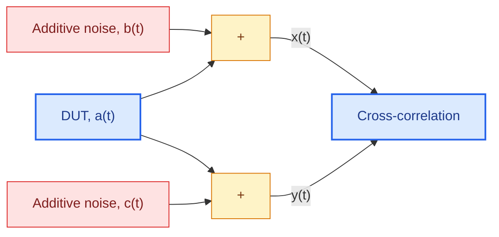
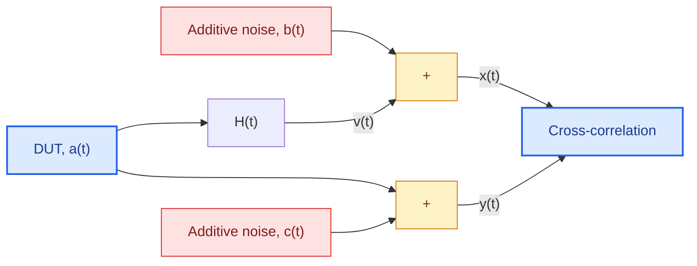

# Cross-Correlation: Definition and Statistical Limits

## Measurement principle

Cross-correlation is a measurement technique that allows a common signal component to be distinguished from independent additive noise contributions. The principle relies on acquiring two signals that share the same underlying source but are affected by different noise sources.

The measurement system considered in this article is illustrated in the following diagram. The device under test (DUT) generates the signal \(a(t)\), which is split into two measurement paths. Each path is affected by a different additive noise contribution, \(b(t)\) and \(c(t)\), resulting in the measured signals \(x(t)\) and \(y(t)\), respectively.

The two measured signals can therefore be expressed as

$$
x(t) = a(t) + b(t)
$$

$$
y(t) = a(t) + c(t)
$$

where \(a(t)\) represents the common signal generated by the DUT, while \(b(t)\) and \(c(t)\) represent the additive noise contributions affecting the two measurement channels.

## Cross-correlation definition and estimator

The cross-spectrum between the two measured signals is defined as

$$
S_{X,Y}=\lim_{T \to \infty} \frac{2}{T} E[X^\*(f,T)Y(f,T)]
$$

where \(X(f,T)\) and \(Y(f,T)\) are the Fourier transforms of the measured signals over a time interval \(T\), and \(E[\cdot]\) denotes the expected value.

In practice, the cross-spectrum is estimated by averaging the cross-products obtained from \(N\) measurement records:

$$
\widehat{S}_{X,Y} = \frac{2}{NT}\sum_i^N X^\*_i(f,T)Y_i(f,T)
$$

Under the assumption that the additive noise contributions are mutually uncorrelated and uncorrelated with the DUT signal, cross-correlation suppresses the contribution of the independent noise terms in the average. Consequently, the estimator converges towards the spectrum of the common signal component:

$$
\widehat{S}_{X,Y} = S_A + O(1/\sqrt{N})
$$

The statistical uncertainty of the estimator is described by its variance:

$$
VAR[|\widehat{S}_{X,Y}|]= \frac{S_XS_Y}{N}
$$

This expression shows that the variance decreases as the number of averaged measurement records increases. Increasing \(N\) therefore improves the statistical stability of the cross-correlation estimate.

## Real-part cross-correlation estimator

The common signal contribution can be further isolated by considering the real and imaginary parts of the cross-spectrum. To understand this property, consider the expected value of the product of the two Fourier transforms:

$$
E[X^\*Y] = E[(A+B)^\*(A+C)] = E[A^\*A]+E[A^\*C]+E[B^\*A]+E[B^\*C]
$$

The term \(E[A^\*A]\), which corresponds to the DUT auto-spectrum \(S_A\), is real-valued. The remaining terms describe cross-products involving the DUT signal and the additive noise contributions, as well as the cross-product between the two noise contributions.

Under the appropriate statistical assumptions, these additional terms do not contribute a systematic DUT spectrum component to the imaginary part of the cross-spectrum. The real part can therefore be used to estimate the common signal spectrum while reducing the influence of noise-related fluctuations.

The corresponding estimator is

$$
\Re(\widehat{S}_{X,Y}) = \Re(\frac{2}{NT}\sum_i^N X_i^\*(f,T)Y_i(f,T)))
$$

Its variance is expressed as

$$
VAR[\Re(\widehat{S}_{X,Y})]= \frac{1}{2N}(S_XS_Y +\Re(S_{X,Y})+\Im(S_{X,Y}))
$$

The real-part estimator provides an alternative way to exploit the shared signal component in the two measurement channels. Its statistical performance depends on the spectral properties of the measured signals and on the correlation assumptions made for the noise contributions.

# Cross-Correlation for Estimating the System Transfer Function

## Measurement configuration

Cross-correlation can also be used to estimate the transfer function of a system when the signal of interest passes through a device under test and the measurement channels are affected by independent additive noise.

In this configuration, the DUT signal \(a(t)\) passes through a system with transfer function \(H(t)\) in the first measurement path. The output of this system is affected by the additive noise \(b(t)\). The second measurement path provides a reference signal, also derived from \(a(t)\), and affected by a different additive noise contribution, \(c(t)\).

The measurement configuration is illustrated below.

The two measured signals are described by

$$
x(t) = a(t)*H(t) + b(t)
$$

$$
y(t) = a(t) + c(t)
$$

The first signal contains the DUT signal after it has passed through the system under investigation, whereas the second signal acts as a reference. Cross-correlating the two measurements allows the transfer characteristics of the system to be estimated while reducing the influence of uncorrelated additive noise.

## Transfer function estimation

The magnitude of the estimated transfer function can be obtained from the cross-spectrum and the reference signal spectrum:

$$
|\widehat{H}_{X,Y}| = \frac{|\widehat{S}_{X,Y}|}{S_Y}
$$

The spectrum at the output of the system can then be estimated as

$$
\widehat{S}_{V}= S_A|\widehat{H}_{X,Y}|^2 = \frac{|\widehat{S}_{X,Y}|^2}{S_Y}
$$

These relationships connect the cross-spectrum to the transfer function magnitude and to the output spectrum. They are useful when the reference channel provides an estimate of the input signal and the noise contributions are sufficiently uncorrelated.

## Coherence and statistical uncertainty

The magnitude-squared coherence is defined as

$$
\gamma_{X,Y}^2 =\frac{|\widehat{S}_{X,Y}|^2}{S_XS_Y}
$$

Coherence characterizes the relationship between the two measured signals and provides an indication of how reliably the transfer function can be estimated from their cross-spectrum.

The variance of the estimated transfer function magnitude is given by

$$
VAR[|\widehat{H}_{X,Y}|] = \frac{(1-\gamma_{X,Y}^2)|\widehat{H}_{X,Y}|^2}{2\gamma_{X,Y}^2N}
$$

The variance of the estimated output spectrum is expressed as

$$
VAR[\widehat{S}_{V}] = \frac{(2-\gamma_{X,Y}^2)\widehat{S}_{V}^2}{\gamma_{X,Y}^2N}
$$

These expressions relate the statistical uncertainty of the estimates to the number of averaged records and the coherence between the measurement channels. As the number of averages increases, the variance decreases. Higher coherence also generally corresponds to a more reliable transfer function estimate and lower statistical uncertainty.

## Reference

[1] Bendat, Julius S., and Allan G. Piersol. *Random Data: Analysis and Measurement Procedures*. John Wiley & Sons, 2011.
